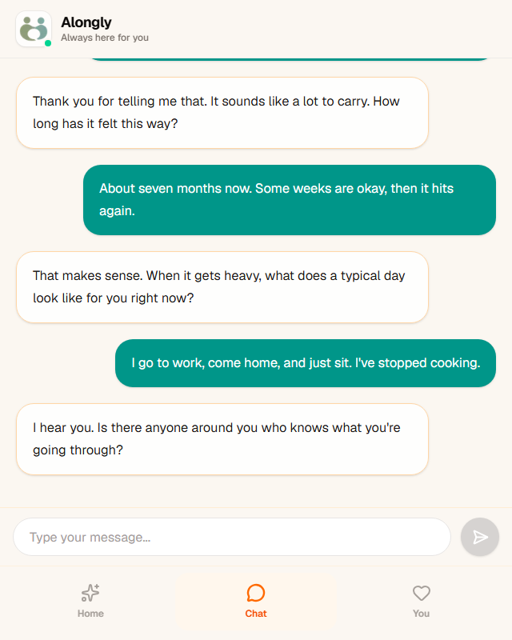
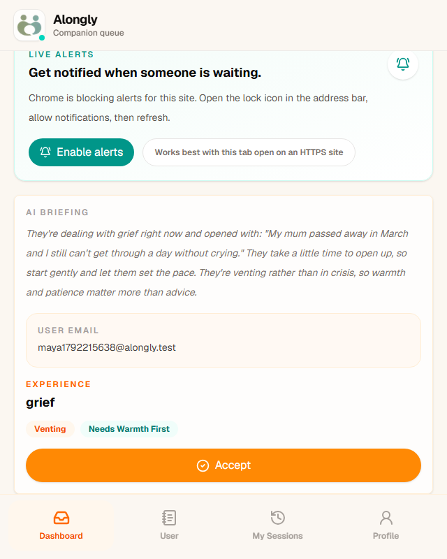
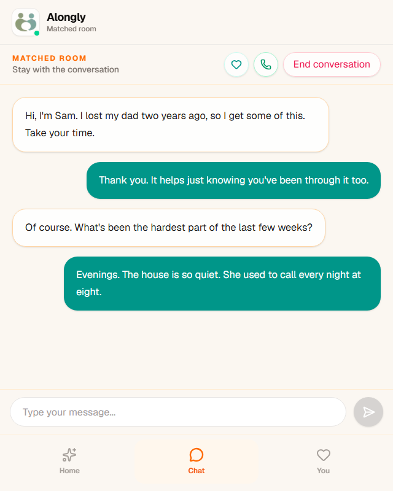
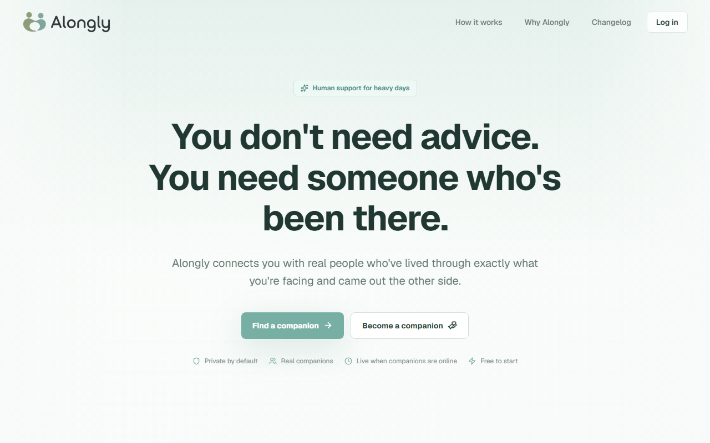
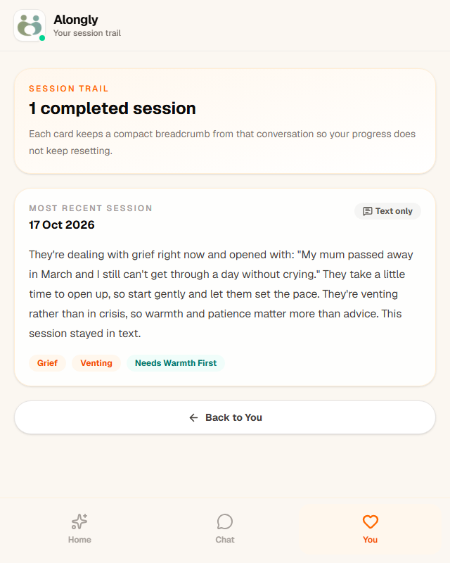
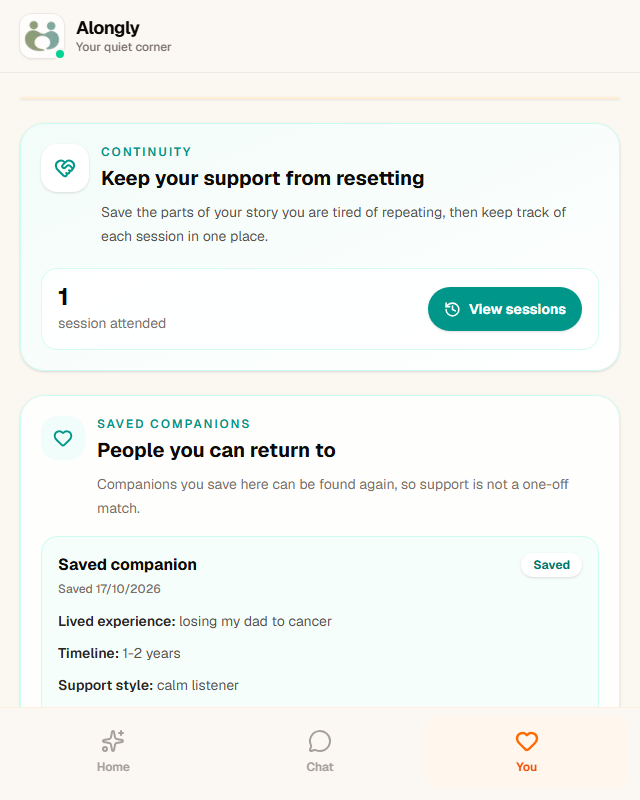

Alongly
=======

**Peer support for heavy days: a short AI intake, a human companion who has been through something similar, and a private room to talk in.**

Alongly is a small Next.js + Supabase app. Someone who is struggling has a short chat with an AI that works out what they are carrying, then a real person who has lived through something similar accepts the request from a live queue and the two of them talk in a private text room, with an optional voice call. It is peer support, not therapy, and it says so everywhere.

[](LICENSE)
[](https://nextjs.org)
[](https://supabase.com)
[](https://vercel.com/new/clone?repository-url=https%3A%2F%2Fgithub.com%2Fsyedzeeshan-27%2FALONGLY&env=NEXT_PUBLIC_SUPABASE_URL,NEXT_PUBLIC_SUPABASE_ANON_KEY&envDescription=Supabase%20project%20URL%20and%20anon%20key.%20Run%20supabase%2Fmigrations%20first.&envLink=https%3A%2F%2Fgithub.com%2Fsyedzeeshan-27%2FALONGLY%23deploy-your-own&project-name=alongly&repository-name=alongly)

**Live demo:** https://alongly.vercel.app <!-- TODO: replace with your Vercel URL after deploying (see "Deploy your own") -->

* * *


The recording above (about a minute, sped up) shows both sides at once. Left: a user signs up, talks to the intake companion, and waits. Right: a companion goes online, reads the three-sentence briefing, accepts, and the two talk in a live room. Everything in it runs locally with **no paid keys**: the intake is in demo mode. A sharper MP4 of the same run is at [docs/media/demo.mp4](docs/media/demo.mp4).

What it does
------------

**For the person asking for support**

- A five-message intake chat that is warm rather than clinical. It quietly works out three things: what they are going through (loneliness, anxiety, grief, burnout), whether they are venting or in crisis, and whether they open up fast or need warmth first.
- A three-sentence **companion briefing** written from that conversation, so the human who picks them up does not start from zero.
- A "finding your person" screen that waits for a live match, then drops them straight into the room.
- A private text room with realtime messages, a one-tap voice call (Jitsi), a "save this companion" heart, and a clean way to end the conversation.
- A session trail and an optional **user context card** ("what helps", "what to avoid") kept on their device, so support does not keep resetting.
- A mood check-in on the home screen and a breathing exercise for the wait.

**For the companion**

- Role-based signup, then a short setup form: what you went through, how long ago, and your style (calm listener, practical thinker, warm encourager).
- A live dashboard with an online/offline toggle, a sound chime, and optional desktop notifications when someone is waiting.
- Each waiting request shows the briefing, the tags, and the user's context card before you accept.
- Your own session history with a quick "how did it go" note.

**Under the hood**

- Postgres with row-level security: a user only sees their own requests, a companion only sees waiting requests and rooms they accepted, and only the two people in a matched room can read or send its messages.
- Supabase Realtime for the queue and the rooms, with polling as a backstop.
- One SQL file sets up the whole database, and it is safe to run twice.
- Works as an installable mobile web app (manifest and icons included).

Screenshots
-----------

| Intake chat | Companion queue with briefing | Matched room |
| --- | --- | --- |
|  |  |  |

| Landing page | Session trail | Your space |
| --- | --- | --- |
|  |  |  |

Quickstart
----------

You need Node 20+ and either Docker (for a local Supabase) or a free Supabase project. No Anthropic key is needed to try it: without one the intake runs in **demo mode**, a scripted companion that still produces tags and a briefing.

```bash
git clone https://github.com/syedzeeshan-27/ALONGLY.git alongly
cd alongly
npm install
cp .env.example .env.local
```

**Option A: local Supabase (Docker, nothing to sign up for)**

```bash
npx supabase start
```

It prints a `Project URL` and a `Publishable` key. Put them in `.env.local` as `NEXT_PUBLIC_SUPABASE_URL` and `NEXT_PUBLIC_SUPABASE_ANON_KEY`. The schema in `supabase/migrations` is applied automatically, and email confirmation is off, so signups log in straight away. (On Windows, `npx supabase start` from PowerShell works the same; the local ports are `553xx` because Windows often reserves the default `543xx` range.)

**Option B: hosted Supabase (free tier)**

1. Create a project at [supabase.com](https://supabase.com).
2. Open **SQL Editor**, paste the contents of `supabase/migrations/20260601000000_alongly_schema.sql`, and run it.
3. In **Project Settings → API**, copy the project URL and the anon/publishable key into `.env.local`.
4. Optional: under **Authentication → Providers → Email**, turn off "Confirm email" if you want signups to log in without clicking an email link.

Then:

```bash
npm run dev
```

Open http://localhost:3000. To see a match happen, open a second browser (or a private window) so you can be the user in one and the companion in the other:

1. Window 1: **Find a companion** → sign up as a *user* → go to **Chat** and send five messages.
2. Window 2: **Become a companion** → sign up as a *companion* → fill in the setup form → flip the toggle to **Online**.
3. The request appears in the companion's queue with its briefing. Click **Accept** and both windows land in the same room.

Requirements and keys
---------------------

| What | Needed? | Cost | Notes |
| --- | --- | --- | --- |
| Node.js 20+ | Yes | Free | Next.js 16 needs a current Node. |
| Supabase (Postgres, Auth, Realtime) | Yes | Free tier | Local via Docker with `npx supabase start`, or a hosted project. Free hosted projects pause after about a week idle; the app then shows "We can't reach our servers" on login. |
| `ANTHROPIC_API_KEY` | No | Paid, pennies per chat | Turns on the real AI intake and briefing (`claude-opus-5-5` by default, override with `ANTHROPIC_MODEL`). Leave it empty for demo mode. |
| Jitsi | No | Free | Voice calls use the public `meet.jit.si` by default. Set `NEXT_PUBLIC_JITSI_DOMAIN` to your own Jitsi or JaaS domain for anything beyond testing. |
| `NEXT_PUBLIC_CONTACT_EMAIL` | No | Free | Shown on the contact, privacy and terms links. Defaults to this repo's issues page. |
| Vercel | No | Free tier | Easiest place to host it. Any Node host works. |

All of these live in `.env.example`. Nothing is hardcoded to a person or an account.

Deploy your own
---------------

1. Fork or clone this repo to your GitHub account.
2. Set up Supabase (Option B above) and run the schema SQL.
3. Click the **Deploy with Vercel** button at the top, or in Vercel choose **Add New → Project** and import the repo. Vercel detects Next.js; keep the defaults.
4. Add the environment variables when Vercel asks: `NEXT_PUBLIC_SUPABASE_URL`, `NEXT_PUBLIC_SUPABASE_ANON_KEY`, and optionally `ANTHROPIC_API_KEY`, `NEXT_PUBLIC_CONTACT_EMAIL`, `NEXT_PUBLIC_JITSI_DOMAIN`.
5. Deploy. Then in Supabase go to **Authentication → URL Configuration** and add your Vercel URL (for example `https://alongly.vercel.app`) as the Site URL and to the redirect list, so confirmation links come back to the right place.
6. Put the URL in the **Live demo** line of this README.

Project layout
--------------

```text
app/
  page.tsx                  Landing page
  signup/ login/ auth/      Email + password auth, role choice, confirm handler
  home/ chat/ talk/         User home, AI intake chat, "finding your person"
  room/[id]/                Matched room: realtime messages, voice call, save companion
  sessions/ you/ breathe/   Session trail, context card + saved companions, breathing
  companion-setup/          Companion onboarding form
  companion-dashboard/      Live queue with briefings, alerts, accept
  companion-briefings/      Briefing + context card view for companions
  companion-sessions/       Companion history
  companion-profile/        Edit companion style
  api/chat/route.ts         Intake + briefing endpoint (Claude, or demo mode)
  components/               App shell, landing sections, cards
lib/
  intake-demo.ts            Scripted intake used when there is no Anthropic key
  auth.ts                   Role helpers and safe redirects
  supabase/                 Browser/server clients, route protection (proxy), DB types
  site.ts                   Contact link config
supabase/
  config.toml               Local Supabase settings (ports, auth)
  migrations/               One SQL file: tables, RLS policies, signup trigger, realtime
public/brand/               Icons and wordmark
proxy.ts                    Next.js proxy: refreshes the session and guards routes by role
```

Scripts: `npm run dev`, `npm run build`, `npm run start`, `npm run lint`, `npm run test:e2e`.

Tests
-----

`npm run test:e2e` runs the Playwright end-to-end suite in `e2e/`. It starts the app itself and needs a local Supabase running (`npx supabase start`); it reads the URL and keys from `supabase status`, so there is nothing to configure. No Anthropic key is used: the intake runs in demo mode. The suite covers:

- the landing page and its two signup links;
- a build with no Supabase variables at all (landing page still renders, app routes send you to `/login` with the setup notice);
- the full match: a user signs up and finishes the intake, a companion signs up, fills in the setup form, goes online and accepts, both talk in the room, the user saves the companion and ends the conversation.

The first run downloads a browser with `npx playwright install chromium`. The same checks (lint, types, build, e2e) run on every push and pull request in GitHub Actions (`.github/workflows/ci.yml`).

Safety
------

Alongly is non-clinical peer support. It is not therapy, diagnosis, emergency care, or a replacement for a licensed professional, and the product copy says so. If someone may be in immediate danger, point them to local emergency services (112 in most of Europe and India, 911 in the US and Canada, 999 in the UK). In the US, 988 is the Suicide and Crisis Lifeline.

Honest limitations
------------------

- **Demo mode is scripted.** Without an Anthropic key the intake replies are canned and the tags come from keyword matching. It proves the flow, not the conversation quality.
- **The public Jitsi server is for testing only.** `meet.jit.si` limits embedded rooms and may ask the first participant to sign in. For real use, run your own Jitsi or use a JaaS domain via `NEXT_PUBLIC_JITSI_DOMAIN`.
- **No moderation or safety tooling.** There is no reporting, blocking, companion vetting, or crisis escalation beyond the copy. The `intensity_tag` of "crisis" is surfaced to the companion but nothing else acts on it.
- **Matching is first come, first served.** Any online companion can accept any waiting request; tags are shown, not used to route.
- **Companions see the user's email** on a waiting request so they can recognise returning people. Decide whether that is right for your deployment before inviting strangers.
- **Email confirmation depends on your Supabase settings.** With confirmations on, new users must click the link before they can log in; the signup screen tells them so.
- **The tests cover the happy path.** The e2e suite exercises one full match in demo mode; there are no unit tests, and failure cases (lost realtime connection, a request accepted twice, Jitsi) are not tested.
- **Mobile-first web app, not a native app.** It installs from the browser but there are no push notifications when the tab is closed.

Licence
-------

MIT. See [LICENSE](LICENSE).
